# IMPLEMENTATION_PLAN.md — 功能完善与双入口交互收束实施计划（修订版）

> **核心原则**：先业务，后交互；数据合规审查前置；禁止直接提交 `main`；每个阶段独立分支、可审查 PR 与独立回滚方案；**到达 Phase 2 业务验收门禁后停止并提交报告，未获批准前不进入网页阶段（Phase 3–6）**。

---

## 一、总体阶段路线

```mermaid
flowchart LR
    P1A["PR-1A: 数据合规审查 + 基线整合 + 按领域拆分 Handler"] --> P1B["PR-1B: ShiftyPad/权限 + 养成历史隔离 + 外部引擎安全 (P0)"]
    P1B --> P1C["PR-1C: 单人突袭正确性/五队 + 愿望单真实规则 (P0)"]
    P1C --> P1D["PR-1D: 咨询 + 同步器 + 超限真实规则/对比"]
    P1D --> P1E["PR-1E: 卡池板 + 三套订阅统一治理 + 九宫格统一 T2I"]
    P1E --> P2["Phase 2: 业务完成门禁 (STOP · 交付三份验收报告)"]
    P2 -. "批准后" .-> P3["Phase 3: 统一功能目录"]
    P3 -.-> P4["Phase 4: 公共功能大厅 (含日程 & 随机塔罗群反馈 E2E)"]
    P4 -.-> P5["Phase 5: 个人指挥官工作台"]
    P5 -.-> P6["Phase 6: 复杂交互整合 & 全量 QQ-Web-QQ 闭环"]
    P6 -.-> P7["Phase 7: 最终验收"]
```

---

## 二、Phase 1 详细实施拆分（PR-1A 至 PR-1E）

### PR-1A：数据许可审查、基线合一与职责拆分
- **前提**：PR #142（8 类帮助导航 V2）先行审查并合入 `main`；保留 `E:/_codex_work/nikkehub-ds`（`9968a50`）本地只读备份，从新 `main` 创建 `feat/p1a-compliant-baseline`。
- **范围**：
  1. **数据许可合规前置**：仅随仓保留 MIT 授权衍生映射 `assets/data/solo_raid_engine_names.json` 与 `integrations/nikke_calc/LICENSE-nikke-calc.txt`。**禁止将 `counsel_bank.json`、`sync-level-costs.json`、`overload_recommendations.json` 与 NikkeHub 抓取的 `solo_raid_seasons.json` 提交至公开仓库**；更新 `core/providers/toolbox.py`、`NOTICE` 与相关测试，确保缺省内置表时安全降级为“未导入”。
  2. **合并 `9968a50` 代码并保留 `3d33f2f` + PR #142**：融合 `command_runtime.py`（保留 `_legacy` 多词拼接、PR #142 门禁帮助与新命令路由）及 `features/help/{catalog,renderer}.py`（将新增主题融入 8 类结构并保留旧分类兼容）。
  3. **按业务职责拆分 `toolbox.py`**：拆为 `info_feeds.py`、`calc_tools.py`、`solo_raid.py`、`shiftypad.py`、`growth.py`、`favorite_grid.py`，共享读取抽取至 `_toolbox_shared.py`，并通过轻薄 facade/装配函数保持 `main.py` ≤ 300 行。
  4. **架构扫描修复**：`scripts/audit/architecture_metrics.py` 排除 `output/`。
- **回滚方案**：`git revert` PR-1A 合并提交即可恢复至 PR #142 合入态。

### PR-1B：P0 安全、账号隔离与外部引擎加固
- **范围**：
  1. **ShiftyPad 上游验证与会话安全（P0）**：
     - 仅在用户提供本人授权测试账号/OpenID 时执行有限只读验证；未取得实测确认前将上游契约显式标为 `BLOCKED` 并新增默认关闭开关 `enable_shiftypad_readonly: false`。
     - 重构 `integrations/web/shiftypad_service.py` 复用竞技场一次性安全会话模式（`GET /open/{token}` 不消费 → `POST /api/claim` → `HttpOnly+Secure+SameSite=Lax` Cookie + `Origin` + `CSRF` + `frame-ancestors 'none'` + 16KB body 校验，彻底消除 URL 查询串传 token）；修复 `storage.py` `can_sync` 反转、换绑 `bound_at` 未重置与 `encode_shiftypad_uid`。
  2. **第三方 `nikke-api.pages.dev` 管控**：新增默认关闭的管理员开关 `enable_public_share_api: false`，开启前提示用户第三方外传字段范围并要求明确确认。
  3. **养成历史跨账号隔离与防并发回写（P0）**：
     - 快照存储键绑定 `(actor_id, game_identity)`，避免直接换绑混染；
     - `RosterGrowthHistory` 区分缺失 `None` 与数值 `0`，修复同日去重；
     - `清空` 命令覆盖 `growth` + `roster_growth`，并引入 `clear_generation` / `cleared_at` 防并发在途查询写回已清理数据。
  4. **外部 `nikke-calc` 引擎隔离与可信校验（P0）**：
     - `asyncio.Semaphore` 提升至实例级共享；使用最小环境白名单（绝不透传 `os.environ` 密钥）；强制输出上限、总体超时预算与进程组回收；
     - 执行独立 `git rev-parse HEAD` & `git status --porcelain`，失败或未命中 `67835ca` 绝不标记 `version_ok=True`（禁止静默回填伪造版本）。
- **回滚方案**：独立 PR 回滚；开关级可即时关闭 `enable_shiftypad_readonly` 与 `enable_public_share_api`。

### PR-1C：单人突袭正确性、五队编组与愿望单真实规则
- **范围**：
  1. **单人突袭**：修复 `builder.py` `_boss_weakness_element()` 读取 `boss.weakness`；修复 `engine.py` `resource_id` 查表与硬编码赛季 43 文案；修复 `ui/payloads/solo_raid.py` 与方案回查的估算标签硬编码，真实透出引擎来源与说明。
  2. **愿望单推荐**：按现行可核验游戏规则实现普通招募愿望单（**按企业极乐净土/米西利斯/泰特拉 5 槽 + 朝圣者/超标准分区，仅限 SSR，剔除 SR/R 与联动角色**）；修复 160 墙仅计 3 星 SSR、分组排序键及全别名解析；支持可核验排除规则并在数据不足时明确降级。
- **回滚方案**：独立 PR 回滚，不影响现有联盟突袭或竞技场模块。

### PR-1D：咨询、同步器与超限助手完善
- **范围**：
  1. **咨询**：保留无授权外置导入模式与明确缺口说明（未取得合法中文题库前标 `BLOCKED`），完善精确匹配与模糊匹配区分、别名支持及游戏内选项位置免责提醒。
  2. **同步器**：保证已验证等级区间计算准确；新增“当前库存可升几级”计算；未知等级/前哨日产/箱子消耗不作无依据公式外推，引导用户手动输入或导入；更新脚本补充往返 Schema 校验与回退。
  3. **超限助手**：统计跨 4 件装备目标总行数防止超额锁定；结合官方 `overload_tiers.json` 1–15 阶数据给出阶位提醒；按可核验真实洗炼规则升级模拟（重洗整件未锁词条、同件不重复、模块消耗递增、明确标注未经官方证实的概率假设；正式模拟使用真随机，`seed` 仅限测试）；增加绑定账号实际装备词条与目标的对比能力（严格区分 5 名已知角色、通用默认与未知覆盖）。
- **回滚方案**：独立 PR 回滚。

### PR-1E：卡池板、三套订阅统一治理与九宫格统一 T2I
- **范围**：
  1. **卡池板**：修复 `build_board()` 过滤参数导致的 `unclassified` 误计数。
  2. **三套订阅统一审查（`feeds.py` / `calendar/subscriptions.py` / `announcement/delivery.py`）**：统一投递状态、幂等/去重键、调度开关门禁与异常 baseline 保留策略，清理 `feeds.py` 死字段 `reminder_hours`，同时明确保留“活动截止 @提醒”“管理员公告推送”“新闻/视频可选订阅”三种业务语义不相互覆盖。
  3. **本命九宫格统一 T2I 规范**：遵循仓库统一 T2I 渲染规范（不再维护互相冲突的两套图片布局），修复 `templates/t2i/favorite_grid.html` 与 `ui/payloads/favorite_grid.py` 的画布高度、内置字体与缺失头像展示，**必须实际生成图片验证标题、中文字体、头像裁剪与底行完整性**；清理或按规范淘汰重复 Pillow 布局，优化排行榜存储读取。
- **回滚方案**：独立 PR 回滚。

---

## 三、Phase 2：业务完成门禁（停止点）

在 PR-1A 至 PR-1E 全部合入测试基线并完成全量回归与真机可用验收后，生成并提交以下门禁交付物供审阅：
1. `docs/refactor/BUSINESS_COMPLETION_REPORT.md`（逐项区分：代码完成 / 自动化测试完成 / 真实环境验收完成）
2. `docs/refactor/CAPABILITY_MATRIX.md`（BlaBlaLink / ShiftyPad / 手工 / 未绑定 能力与权限边界矩阵）
3. `docs/refactor/DATA_SOURCE_REGISTRY.md`（全部数据源来源、版本、核验日期、覆盖、许可结论、更新与回退策略）
4. 全量测试结果、实际渲染截图检查与外部阻塞清单。

> **门禁停止线**：未获项目所有者审阅批准 Phase 2 交付报告前，**严禁进入 Phase 3（统一功能目录）、Phase 4（公共功能大厅）、Phase 5（个人工作台）及 Phase 6–7（网页闭环开发）**。

---

## 四、后续网页阶段保留约束（Phase 3–7 备案）

- **唯一双入口收束**：仅保留**公共功能大厅**（导航、口令复制、公开工具、群聊反馈；纯 `@机器人` 仅在无正文时触发）与**个人指挥官工作台**（自助绑定、个人档案按需懒加载、个性化计算、竞技场与单人突袭五队编组、个人设置）。
- **公共大厅首期闭环要求**：在 Phase 4 公共大厅首期开发时，**立即端到端实现并验证「日程」和「随机塔罗」两个群聊反馈场景**，不把 QQ 反馈能力全部拖延至 Phase 6。
- **隐私与分享安全**：公共页绝不读取个人数据；群内分享个人数据须展示发送目标与脱敏预览并取得用户明确确认；消息发送结果未知时严禁自动重试。
